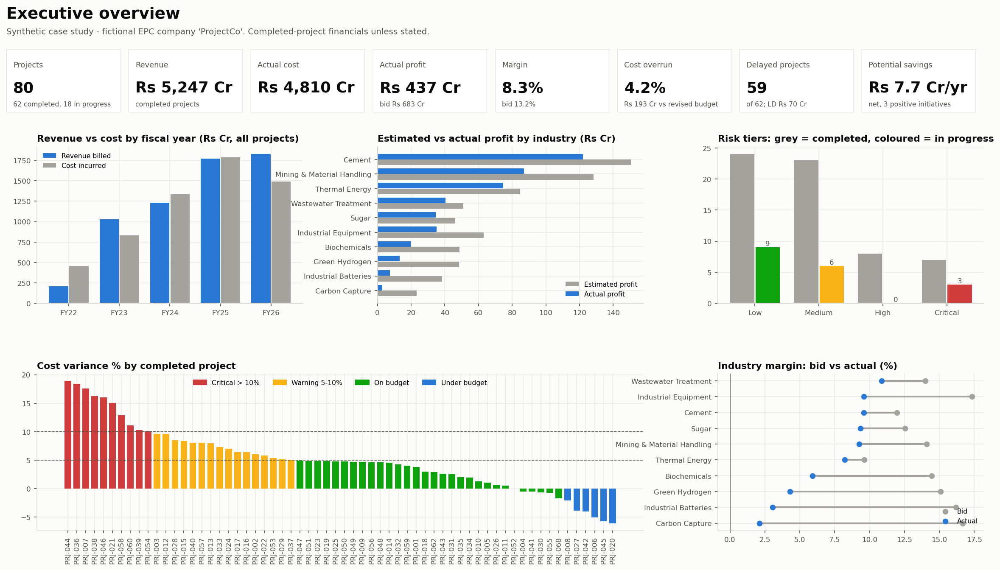
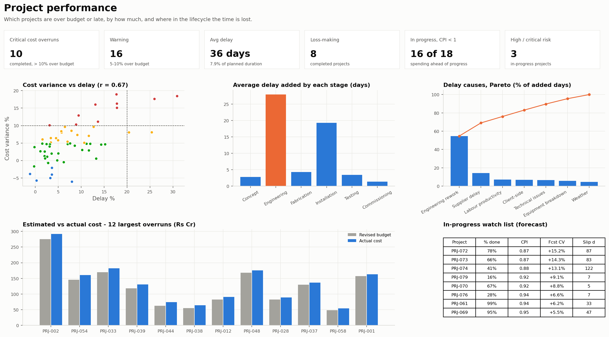
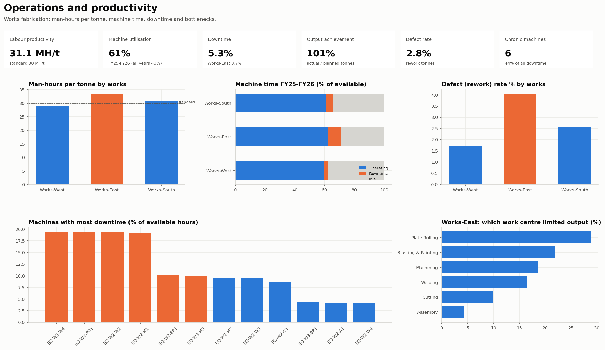
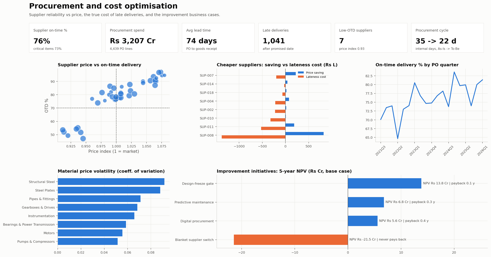

# Industrial Project Cost, Productivity & Profitability Analytics

> An industrial operations analytics case study inspired by the business problems and responsibilities described in an Engineering Internship role at TKIL Industries.
>
> **All data is synthetic.** "ProjectCo" is a fictional company. Nothing here uses, represents or claims access to TKIL data, projects or systems.

**PostgreSQL · Python (pandas, NumPy, Matplotlib, Seaborn) · Excel financial model · Power BI (star schema + DAX)**


*Dashboard preview rendered in Python from the same data and design the Power BI build uses ([build guide](powerbi/BUILD_GUIDE.md)).*

---

## 1. Project overview
ProjectCo is a fictional, mid-sized Indian heavy-engineering and EPC company. It designs, buys, fabricates, installs and commissions plant equipment for sugar, cement, mining, thermal and new-energy clients. This project builds the data model, analysis, financial model and decision dashboard its management would use to protect project margins.

## 2. Business problem
EPC contracts are mostly **fixed-price**: revenue is locked when the contract is signed, so **profit is decided in execution**. Every overrun and every week of delay comes out of margin.

> **Which projects are at financial or operational risk, why are they at risk, and what actions can management take to improve cost, productivity, schedule and profitability?**

## 3. Objectives
1. Measure cost, profit, margin, schedule, productivity and supplier performance consistently across 80 projects.
2. Find the **root causes** of margin loss, not just the symptoms.
3. Identify the live projects that need attention now.
4. Quantify improvement initiatives with payback, ROI and NPV, and recommend which to do first.

## 4. Dataset
A purpose-built simulation (`python/data_generation/`) with real cause and effect, not random numbers:

- Engineering rework leads to late requisitions and extra steel.
- A late critical item idles the site crew and triggers liquidated damages.
- Machine downtime cuts works throughput, which means idle labour and overtime.
- Tight bids push buyers to the lowest-price supplier.
- The steel price spike raises material cost.

| | |
|---|---|
| Projects | 80 (62 completed, 18 in progress at 31 Mar 2026), ₹7,021 Cr contract value, 10 industries |
| Period | FY22 to FY26 (Indian fiscal years, Apr-Mar) |
| Records | ~97,000 fact rows: 4,439 PO lines, 8,835 ledger postings, 13,396 production days, 64,848 machine-days, 3,787 timesheet-weeks, 560 milestones, 510 invoices |
| Master data | 40 suppliers, 94 materials, 37 clients, 84 staff, 3 works, 42 machines |
| Data quality | 2,981 realistic issues injected into the raw extracts (duplicates, inconsistent supplier names, mixed date formats, decimal shifts, missing values, wrong categories) |

Every assumption is documented with its reasoning in [docs/ASSUMPTIONS.md](docs/ASSUMPTIONS.md).

## 5. Data model
Star schema: **8 fact tables** at declared grains and **11 dimensions** ([ERD and design](docs/DATA_MODEL.md), [data dictionary](docs/DATA_DICTIONARY.md) for all 188 columns).

`fact_budget` · `fact_project_cost` · `fact_revenue` · `fact_procurement` · `fact_operations` · `fact_equipment` · `fact_labor` · `fact_milestones`, with dimensions for project, client, supplier, material, location, employee, work centre, equipment, cost category, stage and date.

## 6. Tech stack
| Tool | Used for | Why this tool |
|---|---|---|
| PostgreSQL 15 | Schema with constraints, views, 8 analysis files, reconciliation | Standard SQL, window functions, enforces integrity |
| Python + pandas | Simulation, cleaning, validation, EDA, root cause, risk score, ROI | Repeatable pipelines and statistics |
| Matplotlib / Seaborn | Charts and dashboard preview | Static, reproducible figures |
| Excel | Financial model with live formulas, scenarios, what-if | The tool finance teams audit |
| Power BI + DAX | Semantic model and 4-page dashboard | Decision support for management |

## 7. Data pipeline
```
generate (raw extracts with issues) -> clean (49 logged rules) -> validate (83 checks)
   -> PostgreSQL (schema, views, 11 SQL checks) + Python analysis (8 modules)
   -> Excel model + Power BI dataset + dashboard preview + data dictionary
```
One command rebuilds everything reproducibly (fixed seed, byte-identical reruns).

## 8. KPIs
Cost variance and status bands; estimated vs actual profit and margin; margin deterioration; earned value (CPI, EAC); delay days and %; stage own-delay; man-hours per tonne; labour efficiency; machine utilisation, downtime and idle %; output achievement; defect rate; supplier on-time %, lead time, price index, total cost to the project; risk score; payback, ROI, NPV. Every formula and threshold is in [docs/KPI_DEFINITIONS.md](docs/KPI_DEFINITIONS.md).

## 9. Analysis
- **SQL:** [sql/](sql/README.md), 8 themed files from basic aggregation to CTEs, correlated subqueries and window functions. Saved results are in `sql/results/`.
- **Python:** [python/analysis/](python/analysis/) covers EDA, cost and profitability, productivity, procurement, delays, root cause and risk, process improvement, and ROI.
- **Excel:** [excel/project_financial_model.xlsx](excel/project_financial_model.xlsx) contains a project lookup, profitability, a cost matrix, a supplier scorecard, an ROI model, a what-if sheet and a self-check sheet. It has been verified in Microsoft Excel.

## 10. Key findings
| # | Finding |
|---|---|
| 1 | **Execution gave away 36% of bid profit.** The 62 completed projects were bid at a 13.2% margin and delivered 8.3%: ₹683 Cr planned, ₹437 Cr earned. Cost overruns took ₹193 Cr and liquidated damages ₹70 Cr. |
| 2 | **Labour (+13.2%) and material (+2.6%) are 67% of the overrun.** Idle site crews, overtime and works downtime inflate labour. |
| 3 | **New-energy projects are under-estimated.** They lost 13.3 margin points against 5.0 for mature industries; risk was priced as margin, not as cost contingency. |
| 4 | **Engineering rework causes 55% of delay.** 59 of 62 projects finished late (average 36 days); delay cost ₹89 Cr. On-time projects made 12.9% margin, badly delayed ones 4.1%. |
| 5 | **Cheaper suppliers are usually still cheaper overall.** The 7 suppliers that deliver on time only 52% of the time saved ₹48 Cr on price against ₹23 Cr of lateness cost. The real problem is critical items ordered too late. A blanket supplier switch would destroy ₹21.5 Cr. |
| 6 | **6 machines (14% of the fleet) cause 44% of downtime.** Works-East needs 16% more man-hours per tonne than Works-West, yet shows the *same* cost per tonne because its labour is cheaper: a cost KPI alone hides the problem. |
| 7 | **3 live projects are at critical risk**, with CPI 0.87-0.88 and forecast overruns of 13-15%. 16 of 18 live projects are spending ahead of progress. |

Full write-up: [docs/BUSINESS_INSIGHTS.md](docs/BUSINESS_INSIGHTS.md). **Method check:** the analysis independently recovered all 7 planted unreliable suppliers and all 4 planted chronic machines.

## 11. Business recommendations
1. **Implement predictive maintenance on the 6 chronic machines now.** Payback is about 3 months and NPV ₹6.8 Cr; the result is measurable within a quarter.
2. **Implement a digital procurement workflow next.** It cuts the internal cycle from 34.5 to 22.2 days (-36%), with an NPV of ₹5.6 Cr; it is the most certain of the business cases.
3. **Pilot a design-freeze stage gate on new-energy projects.** It has the largest NPV (₹13.8 Cr) but the widest uncertainty, so prove it before scaling.
4. **Do not switch suppliers wholesale.** Add delivery-linked clauses for critical items and move the one supplier whose lateness outweighs its discount.
5. **Add a technology contingency of about 7% of cost to new-energy bids**, and review every live project monthly on CPI, EAC and the risk score.

## 12. Dashboard
Four pages, each tied to one user and one decision ([design](powerbi/dashboard_design.md), [DAX measures](powerbi/dax_measures.md), [model](powerbi/data_dictionary.md)). The Power BI dataset is [powerbi/ProjectCo_PowerBI_Dataset.xlsx](powerbi/ProjectCo_PowerBI_Dataset.xlsx).

| Project performance | Operations & productivity | Procurement & cost optimisation |
|---|---|---|
|  |  |  |

## 13. ROI analysis
| Initiative | Investment | Net benefit / yr | Payback | 5-yr NPV (low - base - high) |
|---|---|---|---|---|
| Predictive maintenance | ₹0.55 Cr | ₹2.0 Cr | ~3 months | ₹2.4 - 6.8 - 10.1 Cr |
| Digital procurement | ₹0.70 Cr | ₹1.7 Cr | ~5 months | ₹3.0 - 5.6 - 7.3 Cr |
| Design-freeze gate | ₹0.20 Cr + ₹2.2 Cr/yr | ₹3.9 Cr | < 1 month | ₹0.7 - 13.8 - 27.0 Cr |
| Blanket supplier switch | ₹0.15 Cr + ₹9.3 Cr/yr premium | -₹5.9 Cr | never | negative in every case |

Benefits are computed from the data; costs and effectiveness are stated assumptions tested at low, base and high values ([docs/ROI_ANALYSIS.md](docs/ROI_ANALYSIS.md)).

## 14. Project architecture
```
industrial-project-analytics/
├── run_pipeline.py              # one command: generate -> clean -> validate -> analyse -> outputs
├── data/raw | processed | qa    # messy extracts | star schema | answer key, cleaning log, validation report
├── database/                    # schema.sql, load_data.sql, validation.sql, build_database.sh
├── sql/                         # 00_views + 8 analysis files; results/ holds saved outputs
├── python/
│   ├── data_generation/         # simulation + data-quality injection
│   ├── cleaning/  validation/   # raw -> processed; 83 automated checks
│   ├── analysis/                # 8 analysis modules
│   ├── reporting/               # Excel model, Power BI export, data dictionary
│   └── visualization/           # dashboard preview
├── excel/                       # project_financial_model.xlsx
├── powerbi/                     # dataset, DAX, model, dashboard design, build guide, theme
├── reports/                     # figures/, tables/, metrics.json
└── docs/                        # business problem, assumptions, model, KPIs, quality, process, ROI, insights, interview prep
```

## 15. How to run
```bash
pip install -r requirements.txt
python run_pipeline.py                 # about 20 seconds; rebuilds data, analysis, Excel, Power BI dataset, figures
bash database/build_database.sh        # needs a local PostgreSQL; builds schema, loads, runs all SQL + checks
```
Power BI: follow [powerbi/BUILD_GUIDE.md](powerbi/BUILD_GUIDE.md) (browser service or Desktop).

## 16. Limitations
- **Synthetic data.** Relationships are realistic by design, and the analysis recovered the planted causes, but real data would be noisier and its causes less clean.
- **Assumed cost structures and rates** (cost mix, labour rates, LD terms, initiative costs) are plausible values, not sourced market data. All are listed in ASSUMPTIONS.md.
- **No sensor data.** Machine data is daily summaries, not real-time sensor readings.
- **Simplified finance.** Whole-life project profit; no period accounting (Ind AS 115), tax or cash-flow timing.
- **Critical path is approximated** by stage gates and a pass-through rate, not a full CPM schedule.
- **Not yet built in Power BI.** The dashboard is designed with its dataset and measures prepared; the `.pbix` build is pending a Windows or Power BI service session.
- **No live integration.** Nothing is connected to an ERP or MES.

## 17. Future improvements
- **Real data integration:** connect ERP (SAP MM/PS/FI) and MES extracts through an automated ELT into a cloud warehouse, with scheduled Power BI refresh.
- **IoT condition monitoring** on the bottleneck machines, feeding the predictive-maintenance model (where machine learning genuinely earns its place).
- **Forecasting:** EAC and completion-date forecasts with uncertainty ranges; early-warning risk prediction trained on completed projects once enough real history exists.
- **Full critical-path schedule data** (Primavera / MS Project) to replace the pass-through approximation.
- **Data-quality monitoring** as automated tests on every load (for example dbt or Great Expectations).
