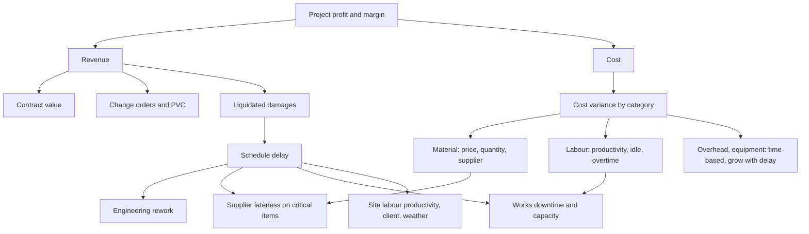

# Business Problem Definition

## Problem statement

ProjectCo (fictional) wins mostly fixed-price EPC contracts. Once a contract is signed its revenue is largely locked, so **profit is decided during execution**. Across its completed projects the company bid a 13.2% margin and delivered 8.3%. Management cannot see early enough which live projects are drifting, why they drift, or which improvements would protect margin.

> **Central question:** Which projects are at financial or operational risk, why are they at risk, and what actions can management take to improve cost, productivity, schedule and profitability?

## Stakeholders and decisions

| Stakeholder | Decision the analysis supports | Primary output |
|---|---|---|
| MD / CFO | Where to send recovery teams; which initiative to fund | Executive page, risk score, ROI cases |
| Head of Projects / PMs | Recovery plans on specific projects | Project page, CPI/EAC watch list |
| Head of Procurement | Supplier strategy, contract terms, process redesign | Supplier scorecard, TCO, As-Is/To-Be |
| Works head | Maintenance priorities, bottleneck relief | Operations page, machine ranking |
| Bid / estimation team | Contingency by industry; estimate corrections | Cost variance by industry and category |

## KPI tree

## Scope

**In scope:**
- 80 projects, FY22 to FY26, with a data cut-off of 31 March 2026.
- Whole-life project economics.
- Works operations (daily).
- Procurement (PO line level).
- Milestones across 7 stages.
- Improvement business cases.

**Out of scope:**
- Statutory accounting (Ind AS 115).
- Real-time sensor data.
- Detailed critical-path scheduling.
- Machine learning, which is not required to answer the question; see README "Future version".

## Success criteria for the analysis

1. Every KPI reconciles across SQL, Python, Excel and Power BI (validated).
2. Every recommendation is quantified, with its assumptions listed and tested at low, base and high values.
3. Each finding states its root cause with evidence *and* a mechanism, not only a correlation.
4. Management can name, from the dashboard, the three in-progress projects that need attention now and the first initiative to fund.
