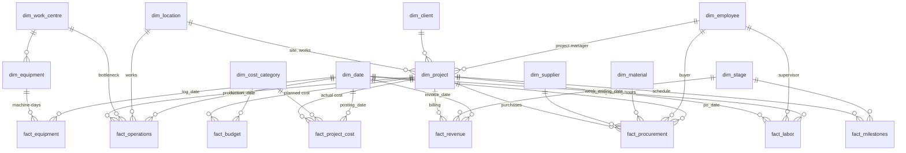

# Data Model

A **star schema**: fact tables hold measurements of business events at a declared grain; dimension tables describe the who, what, where and when. Facts point to dimensions through foreign keys. Implemented in PostgreSQL (`database/schema.sql`); the Power BI variant is in `powerbi/data_dictionary.md`.

## Entity-relationship diagram

## Tables, grain and keys

**Grain** is the most important design decision for a fact table. It is the answer to "what does one row represent?". Mixing grains in one table is how numbers get double-counted.

| Table | Type | Grain (one row =) | Primary key | Foreign keys | Why it exists |
|---|---|---|---|---|---|
| fact_budget | Fact | project x cost category | (project_id, cost_category_id) | project, cost category | Estimated and revised cost, the baseline for cost variance |
| fact_project_cost | Fact | ledger posting: project x category x month x source | document_no | project, category, date | Actual cost, the "what we spent" side of every KPI |
| fact_revenue | Fact | invoice or revenue adjustment | invoice_no | project, stage, date | Revenue including change orders, PVC and LD |
| fact_procurement | Fact | purchase-order line | po_line_id | project, supplier, material, buyer, date | Spend, price, lead time, on-time delivery, process cycle times |
| fact_operations | Fact | works x production day x project | production_id | works, project, bottleneck WC, date | Output, labour hours, rework, conversion cost |
| fact_equipment | Fact | machine x working day | machine_log_id | equipment, date | Availability, downtime, utilisation |
| fact_labor | Fact | project x labour type x week | labour_entry_id | project, supervisor, date | Site and engineering hours, efficiency, idle time |
| fact_milestones | Fact | project x lifecycle stage | (project_id, stage_id) | project, stage | Planned vs actual dates, delay causes |
| dim_project | Dimension | project | project_id | client, site, works, PM | Context for every fact; status, contract value |
| dim_client, dim_supplier, dim_material, dim_employee, dim_location, dim_work_centre, dim_equipment, dim_cost_category, dim_stage | Dimension | one entity | *_id | (some snowflake to a parent) | Descriptive attributes to slice by |
| dim_date | Dimension | calendar day | date | none | Fiscal year (Apr-Mar), quarter, month, working day |

**Why `contract_value` is on `dim_project` and not in a fact.** It is one fixed number per project, signed once. It behaves like an attribute. What *changes* after signing (change orders, PVC, LD) is recorded as events in `fact_revenue`.

**Why budget and actual cost are two tables.** They have different grains: a budget is set per project and category, while actuals arrive monthly from four source systems. Putting them in one table would either repeat the budget on every monthly row (double-counted when summed) or force actuals up to a coarser grain (losing the trend).

## How the design avoids duplication and double counting

1. **Descriptive text lives once, in dimensions.** A supplier's name is stored in `dim_supplier`, not on 4,439 PO lines, so renaming it is a single update. The raw extract *did* carry free-text supplier names, and that is exactly where the inconsistencies came from (see DATA_QUALITY.md).
2. **Each fact has exactly one grain**, written above and enforced by its primary key.
3. **Aggregate before joining.** Joining `fact_budget` (8 rows per project) to `fact_project_cost` (~110 rows per project) row by row would multiply budgets 110 times. Every SQL view and Python function aggregates each fact to the shared grain first, then joins (see `sql/00_views.sql`).
4. **Sub-ledger to ledger reconciliation.** Material, works labour, machine and energy costs exist in detail tables *and* as monthly ledger postings, as in a real ERP. They are never added together. The ledger is the cost total, and the detail tables explain it. Validation proves they agree to the rupee.
5. **The works output grain was chosen deliberately.** Output is recorded once per works, project and day, not per work centre. Every tonne passes through all six work centres, so a per-work-centre grain would count each tonne six times if summed. Work-centre detail is kept where it is additive: machine hours in `fact_equipment`.

## Why a star schema (and why not one big table)

| Option | Problem | Star schema answer |
|---|---|---|
| One flat table with everything | Different grains cannot share rows; repeated text; huge file; double counting | Separate facts at their natural grain |
| Fully normalised (3NF) model for analysis | Many joins for every question; slow and confusing in BI tools | Dimensions are shallow; one join from fact to context |
| Star schema | Some descriptive duplication inside dimensions (accepted) | Fast, simple filters, how Power BI's engine is designed to work |

## How it works in Power BI

- Every relationship is many-to-one from fact to dimension, filtering in a single direction.
- A slicer on `dim_project[industry]` filters every fact table at once, because all facts share `dim_project`.
- `dim_cost_category` is shared by budget and actual cost, so a single visual can show budget vs actual by category.
- Only one relationship between two tables can be active, so `fact_procurement[grn_date]` is inactive and used through `USERELATIONSHIP`.
- For Power BI, client, project manager and location names are flattened into `dim_project` to give a single filter path (details in `powerbi/data_dictionary.md`).

## Scaling notes

At 100x the volume (about 10 million machine-day rows):
- Replace the `date` key with the integer `date_key`.
- Partition `fact_equipment` and `fact_operations` by month.
- Add BRIN indexes on date columns.
- Load incrementally (append new days only).
- Pre-aggregate machine data to machine-week for the dashboard while keeping daily detail in the warehouse.
