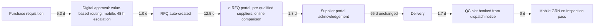

# Process Map: Procurement As-Is and To-Be

Measured from the timestamps on 4,439 PO lines (`python/analysis/process_improvement.py`, SQL Q8.5).

## As-Is

| Step | Mean days | Median | P90 | Value-adding? | Problem seen in the data |
|---|---|---|---|---|---|
| PR approval | 9.3 | 8 | 18 | No: waiting | Manual multi-level approval; 20% of requisitions wait for an absent approver |
| RFQ issue | 1.5 | 2 | 2 | No: admin | Manual re-keying of the requisition |
| Quotes and PO | 15.5 | 15.5 | 20 | Partly | Quote collection by email, manual comparison |
| Supplier confirmation | 3.5 | 4 | 6 | No: waiting | PO sent by email; acknowledgement chased by phone |
| Supplier lead time | 65.3 | 51 | 127 | Yes (external) | Outside this redesign |
| Wait for inspection | 3.3 | 3 | 6 | No: waiting | QC inspector booked only after the goods arrive |
| GRN posting | 1.5 | 1 | 3 | No: admin | Paper inspection report keyed in later |
| **Internal total** | **34.5** | | | | **Approval is 27% of internal time; quotes and PO is the largest single step** |

## To-Be

**How the To-Be times were set (not invented percentages).** For every internal step, the target is the **25th-percentile time ProjectCo already achieves today** on lines of the same value band (under ₹10 L, ₹10 L to ₹1 Cr, over ₹1 Cr). In other words, the company already does it this fast on a quarter of its orders. The digital workflow's job is to make that best quartile the norm. Lines already faster than the target keep their own time.

| | As-Is | To-Be | Saved |
|---|---|---|---|
| Internal procurement cycle (mean days per line) | 34.5 | 22.2 | **12.3 days (-36%)** |
| PR approval | 9.3 | 5.3 | 4.0 |
| Quotes and PO | 15.5 | 12.5 | 3.0 |

## Business impact

Earlier purchase orders mean critical items arrive earlier. For each completed project, the To-Be saving was applied to its A-class (critical) lines, the reduction in lateness past the need-by date was measured, and it was converted to project delay using the pass-through estimated from the data: **0.73 days of project delay per day of critical-item lateness**.

| Result | Value |
|---|---|
| Completed projects whose finish date would have moved earlier | 25 of 62 |
| Project delay days avoided (historical) | 183 |
| Value at each project's delay cost (time-based cost + LD accrual) | ₹8.1 Cr over the history |
| Annual run-rate (17.5 completions per year, FY25-FY26) | ₹2.3 Cr per year, plus buyer time saved |

This feeds the "Digital procurement workflow" business case in `ROI_ANALYSIS.md`. The base case assumes 80% of the target is achieved; the low case 50%.
