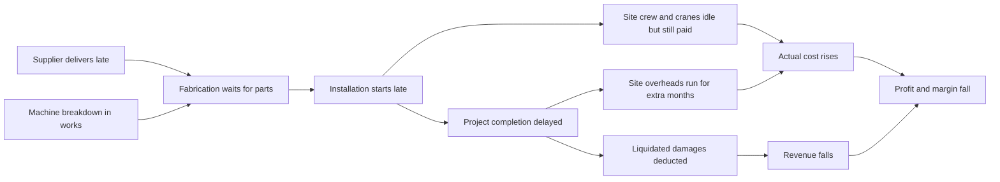

# Phase 1: Business Understanding

> **Goal of this phase:** before touching any data, understand what kind of company we are analysing, how it makes money, how it loses money, and which decisions our analysis must support. An analyst who skips this builds charts; an analyst who does it builds decisions.

---

## 0. Quick reference: Indian number units

Every money figure in this project is in INR (₹). Business presentations in India use **Lakh** and **Crore**:

| Unit | Digits | Equals | In millions |
|---|---|---|---|
| ₹1 Lakh (L) | ₹1,00,000 | 100 thousand | ₹0.1 million |
| ₹1 Crore (Cr) | ₹1,00,00,000 | 100 Lakh | ₹10 million |
| ₹100 Cr | ₹1,00,00,00,000 | 1 billion | ₹1,000 million |

Rule of thumb: **₹1 Cr = 100 L = ₹10 million.** The database stores full rupees; reports display ₹ L or ₹ Cr.

---

## 1. What kind of company are we modelling?

### The one-sentence version

> ProjectCo is the company that **builds the factory**, not the company that **runs** the factory.

A cement company makes cement. To make it, the cement company needs a crusher, a rotary kiln, a clinker cooler, grinding mills and conveyors. It does not build those itself. It hires a **heavy-engineering / EPC company** to design them, buy the parts, fabricate the steel structures, install everything on site and get the plant running. That EPC company is what we are modelling.

### What ProjectCo supplies, by industry

These are synthetic case-study categories, based on the kinds of industries named in the job description. They are **not** actual TKIL projects.

| Industry | What the client produces | What ProjectCo builds for them (typical scope) |
|---|---|---|
| Sugar | Sugar, ethanol, cogeneration power | Cane handling, mill tandems, boilers, process house equipment |
| Cement | Cement | Crushers, preheaters, rotary kilns, coolers, grinding mills |
| Mining & Material Handling | Coal, iron ore, limestone | Conveyors, stacker-reclaimers, wagon tipplers, crushing plants |
| Thermal Energy | Electricity, steam | Boilers, coal handling plants, ash handling |
| Industrial Equipment | Inputs to other plants | Gearboxes, mills, presses, heavy fabricated equipment |
| Green Hydrogen | Hydrogen from electrolysis | Electrolyser balance-of-plant, compression, storage |
| Industrial Batteries | Battery cells/packs | Plant utilities, material handling, process lines |
| Wastewater Treatment | Clean water | Treatment plants, clarifiers, sludge handling |
| Carbon Capture | Captured CO₂ | Absorber and stripper columns, compression |
| Biochemicals | Ethanol, bio-based chemicals | Fermentation, distillation, evaporation systems |

### How this business is different from a "normal" company

| | Product company (e.g., a car maker) | Project company (ProjectCo) |
|---|---|---|
| What it sells | Thousands of identical units | A handful of one-off, custom-engineered projects |
| Price | Set per unit, changes often | Fixed in a contract, often 1–3 years before the work finishes |
| Duration of one "sale" | Minutes | 10–36 months |
| Size of one sale | ₹5–20 lakh | ₹15–450 crore |
| Where profit is won or lost | Pricing, volume, brand | **Execution**: cost control, schedule control, productivity |

That last row is the whole reason this project exists.

---

## 2. Core concepts for Phase 1

Every concept follows the same seven-part format: what it means, why the business cares, how it is calculated, what the formula means, a tiny example, how it applies to our project, and how to say it in an interview.

### Concept 1: EPC (Engineering, Procurement, Construction)

1. **What it means.** A contract in which one contractor takes responsibility for the whole job:
   - **E**ngineering: design the plant (drawings, calculations, specifications).
   - **P**rocurement: buy everything (steel, motors, gearboxes, cables, instruments).
   - **C**onstruction: fabricate, install, test and commission it on the client's site.

   "Turnkey" means the client gets a plant that works: they "turn the key" and start production.
2. **Why the business cares.** One contractor carries the risk for design errors, late suppliers and site problems. Higher responsibility allows a higher price, but mistakes come out of the contractor's profit.
3. **How it is calculated.** It is a contract structure, not a formula. What we calculate is the cost and schedule of each of its stages.
4. **What that means.** Because E, P and C are linked, a problem in one shows up as a cost in another. A late drawing (E) delays a purchase order (P), which delays installation (C).
5. **Tiny example.** A cement company signs a ₹120 Cr EPC contract for a new clinker cooler. ProjectCo designs it, buys ₹55 Cr of materials and equipment from 30 suppliers, fabricates it in its own works, then erects it on site.
6. **In our project.** Every project moves through seven lifecycle stages (Concept → Engineering → Procurement → Fabrication → Installation → Testing → Commissioning). We track cost, milestones and productivity per stage. Phase 2 explains each stage in detail.
7. **Interview line.** *"In EPC, one contractor owns design, buying and building, so a delay or cost problem in any one of them hits the same profit line. That's why I tracked cost and schedule across all three instead of in silos."*

### Concept 2: Contract value (revenue in a project business)

1. **What it means.** The amount the client agrees to pay for the whole project. For ProjectCo this is the project's **revenue**.
2. **Why the business cares.** It is the ceiling on what the company can earn. On a fixed-price contract it barely changes after signing, so profit can only be protected by controlling cost.
3. **How it is calculated.**
   `Final Revenue = Original Contract Value + Approved Change Orders − Liquidated Damages`
4. **What the formula means.** Start with the signed price. Add money the client agreed to pay for extra scope ("change orders"). Subtract penalties the client deducted for late delivery ("liquidated damages", Concept 5).
5. **Tiny example.** Contract ₹100 Cr. The client adds a second conveyor (+₹6 Cr). The project is 4 weeks late, LD = ₹2 Cr. Final revenue = 100 + 6 − 2 = **₹104 Cr**.
6. **In our project.** `fact_revenue` will hold billing milestones, change orders and LD deductions per project. Total revenue per project must reconcile to this formula. That reconciliation is a validation check in Phase 20.
7. **Interview line.** *"In a project business, revenue is mostly locked in at contract signing, so I treated revenue as the given and focused the analysis on what management can still control: cost and schedule."*

### Concept 3: Fixed-price (lump-sum) vs. cost-plus contracts

1. **What it means.**
   - **Fixed-price (lump-sum):** the client pays an agreed amount no matter what the job actually costs the contractor.
   - **Cost-plus:** the client reimburses actual cost plus an agreed fee or percentage.
2. **Why the business cares.** It decides **who carries the cost risk**. Under fixed-price, every rupee of overrun is the contractor's loss. Under cost-plus, the client absorbs it.
3. **How it is calculated.**
   - Fixed-price: `Contractor Profit = Contract Value − Actual Cost`
   - Cost-plus: `Contractor Profit = Actual Cost × Fee %` (or a fixed fee)
4. **What the formula means.** Under fixed-price, actual cost sits on the "minus" side, so an overrun reduces profit one-for-one. Under cost-plus, a higher cost can even increase the fee. That is why clients prefer fixed-price for large plants.
5. **Tiny example.** Planned cost ₹86 Cr, actual cost ₹92 Cr.
   - Fixed-price ₹100 Cr: profit = 100 − 92 = **₹8 Cr** (instead of the planned ₹14 Cr).
   - Cost-plus at 10% fee: profit = 92 × 10% = **₹9.2 Cr**. The client paid the ₹6 Cr overrun.
6. **In our project.** We assume most ProjectCo contracts are fixed-price (documented in `ASSUMPTIONS.md`). This is why cost variance is our most important financial metric.
7. **Interview line.** *"Because the contracts are fixed-price, the contractor carries the overrun risk, so cost variance flows straight into margin. That made cost variance the first thing I analysed."*

### Concept 4: Profit vs. margin

1. **What it means.**
   - **Profit** is an amount in rupees: what is left after costs.
   - **Margin** is a percentage: how much of each rupee of revenue you keep.
2. **Why the business cares.** Profit tells you *how much* you earned. Margin tells you *how well* you earned it. A big project can earn more rupees at a worse margin, which means it used a lot of capital, people and risk for a thin return.
3. **How it is calculated.**
   `Profit = Revenue − Cost`
   `Margin % = Profit ÷ Revenue × 100`
4. **What the formula means.** Margin divides profit by revenue so that projects of different sizes can be compared fairly.
5. **Tiny example.**

   | Project | Revenue | Cost | Profit | Margin |
   |---|---|---|---|---|
   | A | ₹400 Cr | ₹376 Cr | ₹24 Cr | 6.0% |
   | B | ₹60 Cr | ₹51 Cr | ₹9 Cr | 15.0% |

   Project A earns more rupees, but Project B is the better business. A 5% cost overrun would turn A into a loss (376 × 1.05 = ₹394.8 Cr, leaving only ₹5.2 Cr), while B would still earn ₹6.45 Cr.
6. **In our project.** We calculate **estimated margin** (at bid) and **actual margin** (at completion) for every project. The difference, *margin deterioration*, is a core risk signal (Phase 11).
7. **Interview line.** *"I compared projects on margin, not just profit, because a large project with a thin margin can look impressive in rupees and still be the riskiest one in the portfolio."*

### Concept 5: Liquidated damages (LD)

1. **What it means.** A penalty written into the contract: if the contractor finishes late, the client deducts a pre-agreed amount per week of delay, usually up to a cap.
2. **Why the business cares.** It turns schedule delay directly into lost revenue, on top of the extra cost the delay already causes.
3. **How it is calculated.**
   `LD = min(Weeks Late × LD Rate per Week, LD Cap) × Contract Value`
4. **What the formula means.** Each week late costs a fixed percentage of contract value, but the total cannot exceed the cap. "Weeks late" usually counts any part of a week as a full week.
5. **Tiny example.** Contract ₹100 Cr, LD rate 0.5% per week, cap 5%.
   - 25 days late → 4 weeks (part-weeks round up) → 4 × 0.5% = 2% → **₹2 Cr**.
   - 14 weeks late → 7%, capped at 5% → **₹5 Cr**.
6. **In our project.** We assume LD = 0.5% per week, capped at 5% of contract value (a common structure in Indian EPC contracts; see `ASSUMPTIONS.md`). This links the schedule analysis (Phase 14) to the profitability analysis (Phase 11).
7. **Interview line.** *"Delay hits profit twice: extra cost while the project runs longer, and liquidated damages deducted from revenue. I modelled both, so a schedule slip shows up in rupees, not just days."*

### Concept 6: Cost overrun and cost variance (preview)

Phase 10 covers this in depth. You need the basic idea now because it is central to the business problem.

1. **What it means.** The difference between what a project actually cost and what it was budgeted to cost.
2. **Why the business cares.** On fixed-price contracts, it is the main way profit is lost.
3. **How it is calculated.**
   `Cost Variance (₹) = Actual Cost − Estimated Cost`
   `Cost Variance % = (Actual Cost − Estimated Cost) ÷ Estimated Cost × 100`
4. **What the formula means.** A positive variance means overspending (bad). A negative one means underspending. The percentage version lets us compare a ₹20 Cr project with a ₹400 Cr project.
5. **Tiny example.** Budget ₹10 Cr, actual ₹11.2 Cr → CV = ₹1.2 Cr, CV% = 1.2 ÷ 10 = **12% over budget**.
6. **In our project.** We calculate CV for every project and every cost category, then classify projects as Under budget, On budget, Warning or Critical.
7. **Interview line.** *"I didn't stop at 'Project X is 12% over budget'. I broke the overrun down by cost category to find what drove it, because management can't act on a total."*

---

## 3. The economics in one table

Everything above combines into one example. Read it slowly; it is the business problem in miniature.

**Contract:** ₹100 Cr, fixed-price, bid at 14% margin, so estimated cost = ₹86 Cr.

| Scenario | Revenue | Actual cost | Profit | Margin |
|---|---|---|---|---|
| **A.** On budget, on time | ₹100 Cr | ₹86.0 Cr | ₹14.0 Cr | 14.0% |
| **B.** 6% cost overrun, on time | ₹100 Cr | ₹91.2 Cr | ₹8.8 Cr | 8.8% |
| **C.** 6% overrun **and** 8 weeks late (LD 4% = ₹4 Cr) | ₹96 Cr | ₹91.2 Cr | ₹4.8 Cr | 5.0% |

What this shows:

- A "small" 6% overrun destroyed **37%** of the profit (₹14 Cr → ₹8.8 Cr).
- Adding two months of delay destroyed **two-thirds** of it (₹14 Cr → ₹4.8 Cr).
- Scenario C is optimistic. In reality an 8-week delay also adds cost: site overheads, crane hire and supervision keep running.

Useful rule of thumb: on a project with planned margin *m*, a cost overrun of *x*% cuts the margin by about *x* × (1 − *m*) percentage points. At 14% planned margin, a 6% overrun costs 6 × 0.86 ≈ 5.2 points (14% → 8.8%), and a 10% overrun costs about 8.6 points. **In this business, revenue is decided at the bid; profit is decided in execution.**

---

## 4. Why industrial projects go wrong: the causal chain

Problems in industrial projects rarely stay where they start. They cascade.



### Worked example: the "cheaper" gearbox

A ₹100 Cr project needs a large gearbox. Two suppliers quote:

- Supplier A: ₹1.50 Cr, reliable delivery.
- Supplier B: ₹1.38 Cr (8% cheaper), poor on-time record.

Procurement picks B and saves **₹12 lakh**. The gearbox arrives **25 days late**. It is on the *critical path*: installation cannot continue without it, so the whole project slips 25 days. (Critical path is explained in Phase 2.)

| Consequence | Calculation | Cost |
|---|---|---|
| Erection crew waiting (assume they cannot be redeployed) | 40 workers × ₹2,500/day × 25 days | ₹25 L |
| Crane hire continues | ₹1.2 L/day × 25 days | ₹30 L |
| Site overheads (office, supervision, security) | ₹36 L/month × 25/30 | ₹30 L |
| Liquidated damages | 25 days → 4 weeks × 0.5% × ₹100 Cr | ₹200 L |
| **Total impact** | | **₹2.85 Cr** |

The ₹12 L saving cost the project about **₹2.85 Cr, roughly 24 times the saving.** This is why the procurement analysis (Phase 13) judges suppliers on **total cost to the project**, not on purchase price alone. It is also why a dashboard that ranks suppliers only by price would actively mislead management.

Two honest caveats, because an interviewer will raise them:

1. The delay only becomes this costly because the gearbox was on the critical path. A late item that has slack (spare time in the schedule) may cost nothing.
2. A real crew can sometimes be redeployed, so the idle-labour figure is an upper bound.

---

## 5. Who uses this analysis, and what do they decide?

A dashboard without a decision behind it is decoration. Each part of this project serves a specific person and a specific decision.

| Stakeholder | Their question | Decision our analysis supports | Where in this project |
|---|---|---|---|
| MD / CEO | Which projects threaten this year's profit? | Where to send senior attention and recovery teams | Executive page, risk score |
| CFO / Finance | Are margins holding? Is the estimating process biased? | Bid pricing, contingency levels, cash planning | Profitability model, cost variance |
| Project Managers | Which cost heads and milestones are drifting on my project? | Recovery plans, resequencing, overtime | Project performance page |
| Head of Procurement | Which suppliers are reliable, and which are cheap but costly? | Approved-vendor list, supplier development, contract terms | Supplier scorecard |
| Works / Plant Head | Where is machine downtime and labour productivity worst? | Maintenance priorities, shift planning, capex | Operations page |
| Estimation / Bid team | Do certain cost categories always overrun in certain industries? | Correct future estimates | Cost-driver decomposition |
| Management committee | Which improvement initiative should we fund first? | Investment approval | Business case, ROI |

---

## 6. The exact business problem

### Central question

> **Which projects are at financial or operational risk, why are they at risk, and what actions can management take to improve cost, productivity, schedule and profitability?**

The question has three parts, and each needs a different kind of analysis:

| Part | Type of analysis | Output |
|---|---|---|
| **Which** projects are at risk? | Descriptive: measure and rank | KPIs, thresholds, risk score |
| **Why** are they at risk? | Diagnostic: decompose and trace causes | Cost-driver decomposition, Pareto, root cause |
| **What** should management do? | Prescriptive: quantify options | As-Is/To-Be, business case, ROI, recommendations |

Most student dashboards stop at "which". This project is designed to reach "what".

### Sub-questions by theme

| Theme | Key questions |
|---|---|
| Financial | Which projects are over budget, by how much, and why? Which cost categories drive overruns? Where is margin deteriorating? Estimated vs actual profit and margin? |
| Operational | Where is productivity low, machine utilisation poor, downtime high? Where are labour hours inefficient? Where are the bottlenecks? |
| Procurement | Which suppliers are reliable, late or expensive? Does a lower price lead to a lower total project cost? Which materials have volatile prices? |
| Project management | Which projects are delayed, and why? Which lifecycle stage causes most slippage? What does delay cost? |
| Management | Where can cost be reduced? Which improvement has the best ROI? Which projects need attention now? |

### What "at risk" means

A project is **at risk** when current evidence shows it is likely to miss its planned profit, its planned completion date, or both. Phase 15 turns this into a transparent score that combines cost overrun, schedule delay, supplier exposure, productivity and margin deterioration. We will **derive** the weights from how much each factor actually erodes margin in our data, not pick them by feel.

### Scope

| In scope | Out of scope (and why) |
|---|---|
| Project cost, revenue and profit over the whole project life | Statutory accounting (Ind AS 115 period revenue recognition). We analyse whole-life project economics, which is what management decides on. |
| Works (fabrication shop) operations: machines, labour, output, defects | Real-time sensor data. We use daily summaries, the level a plant MIS report would contain. |
| Procurement: purchase orders, deliveries, prices, supplier quality | Supplier contract negotiation strategy |
| Milestones across 7 lifecycle stages | Detailed critical-path scheduling (Primavera-level) |
| Improvement business cases and ROI | Machine-learning prediction. Not needed to answer the business question; discussed as future work in Phase 22. |

---

## 7. The analyst's thinking framework

Every analysis in this project follows the same ten steps. Learn this sequence; it is how you will structure every interview answer.

```
BUSINESS QUESTION → DATA REQUIRED → DATA QUALITY → METRIC → ANALYSIS
→ ROOT CAUSE → BUSINESS IMPACT → RECOMMENDATION → EXPECTED RESULT → MEASUREMENT
```

Applied to one question. Values in brackets are filled in only after the analysis is actually run in Phase 10; nothing here is a finding yet.

| Step | "Which completed projects are over budget, and why?" |
|---|---|
| 1. Business question | Which completed projects overran their estimated cost, by how much, and which cost categories drove it? |
| 2. Data required | Estimated cost by project and category; actual cost transactions by project, category and date; project attributes (industry, size, project manager) |
| 3. Data quality | Duplicate cost postings? Costs dated before project start? Missing categories? Units in ₹ vs ₹ Lakh mixed? |
| 4. Metric | Cost Variance ₹ and Cost Variance % by project and by category |
| 5. Analysis | Rank projects by CV%; split each overrun into category contributions; Pareto across the portfolio |
| 6. Root cause | Link the top categories to operational evidence: e.g., material overrun ↔ supplier price or late delivery; labour overrun ↔ machine downtime and overtime |
| 7. Business impact | ₹[X] Cr of profit lost; margin down [Y] points vs bid |
| 8. Recommendation | A specific, owned action, e.g., change supplier mix, add price-variation clauses to bids, fund predictive maintenance |
| 9. Expected result | Reduce overrun in category [Z] from [a]% to [b]%, worth ₹[N] Cr a year |
| 10. Measurement | Track CV% by category monthly on the dashboard; compare projects that adopted the change with those that did not |

Steps 9 and 10 matter. Without them, a recommendation is an opinion. With them, it is a commitment management can check.

---

## 8. How to position this project honestly

**Say:**

> "I built an industrial project analytics case study modelled on a mid-sized Indian EPC company, inspired by the responsibilities in TKIL's engineering internship description. Real project cost data is confidential, so I generated synthetic data with realistic cause-and-effect relationships: late suppliers shift milestones, machine downtime raises unit cost, delays trigger penalties. The point is the method: data model, cleaning, SQL and Python analysis, root cause, ROI and a Power BI decision dashboard. The same pipeline would run on real ERP data."

**If asked "So it isn't real data?":**

> "Correct, it's synthetic, and I say so on the first line of the README. What's real is the method and the business logic. I built the data so that the relationships are realistic, then checked that my analysis could recover them. On real data, the same steps apply. The cleaning would be harder and the root causes less clean."

**Never say:**

- "I worked on TKIL's data" or "this is TKIL's dashboard."
- "My recommendation saved ₹X crore." It is a simulated estimate, not an achieved result.
- "The data is realistic" without explaining *how* it was made realistic.

---

## 9. Phase 1 summary

**What we completed**

- Defined the fictional company (ProjectCo), its industries and its business model.
- Defined the central business question, its sub-questions, its stakeholders and its scope.
- Set up the repository structure and the 23-phase roadmap (`docs/ROADMAP.md`).
- Recorded the first set of major assumptions (`docs/ASSUMPTIONS.md`).

**What you learned**

- EPC, contract value, fixed-price vs cost-plus, profit vs margin, liquidated damages, cost variance.
- Why revenue is set at the bid and profit is set in execution.
- How a supplier delay cascades into cost, penalties and lost margin.
- The ten-step analyst thinking framework.

**Business value**

Management gets a clear statement of what the analytics must answer and for whom. Without this phase, the later work would answer questions nobody asked.

---

## 10. Self-test: answer these before Phase 2

Answer in your own words. For numerical questions, show your working, not only the final number. I will grade each answer strictly and ask follow-up questions.

1. In your own words, what does an EPC company sell, and how is its business model different from a company that sells cars or soap?
2. A ₹200 Cr fixed-price contract was bid at a 12% margin. Actual cost came in 8% above the estimate. Calculate the estimated cost, actual cost, actual profit and actual margin.
3. The same project also finished 6 weeks late. LD is 0.5% per week, capped at 5%. Recalculate revenue, profit and margin. Why does the margin fall by more than the LD percentage alone would suggest?
4. Why does a fixed-price contract make cost control the contractor's problem? What changes for the contractor under a cost-plus contract, and why would a client avoid cost-plus?
5. Trace how one late gearbox delivery can reduce project profit. Name at least four separate cost or revenue effects. When would the same late delivery cost almost nothing?
6. The company's revenue grew 25% this year but its profit fell. Give two plausible explanations based on EPC economics.
7. Why is "Project X is 15% over budget" not a useful final answer for management? What three things would they ask next?
8. Which stakeholder uses the supplier analysis, and what concrete decision do they make with it?
9. Explain the difference between profit and margin. Give an example where the project with higher profit is the worse project.
10. Apply the ten-step thinking framework to: "Should we stop buying from Supplier B?" State what goes into each step (no numbers needed).
